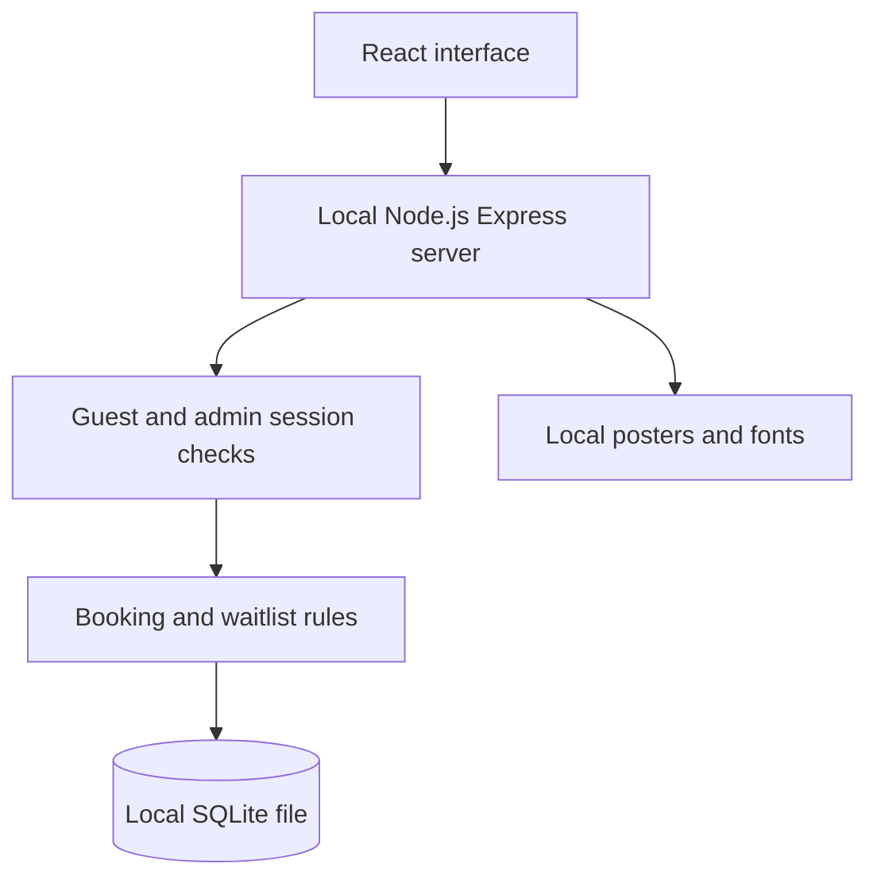

# Local application architecture

The browser and Express API use one origin, http://localhost:3000. In development, Express attaches Vite's middleware after the API routes. In built mode, Express serves `dist/`. Both modes use the same API, sessions and SQLite database.

## Booking flow

1. GET `/api/cinema` creates or verifies a guest session and returns private visitor records.
2. Selecting a seat POSTs the entire selection with action `hold`.
3. The server validates the show, category, seat identifiers and group size. It calculates its own total.
4. One SQLite transaction releases the visitor's previous direct hold and inserts the replacement group. A seat-lock key conflict rolls back all those changes.
5. Other seat maps read `/api/cinema?seatsOnly=1&show=...` about once per second.
6. Confirmation checks ownership, server expiry, lock count and show status before inserting the booking.
7. Cancellation marks the booking cancelled, removes its locks and considers waiting requests.

The SQLite adapter performs each batch synchronously inside `BEGIN IMMEDIATE` and `COMMIT`. A failed write triggers `ROLLBACK`. The application does not split a requested seat group into partial successful bookings.

## Stored records

| Table          | Purpose                                             |
| -------------- | --------------------------------------------------- |
| `holds`        | Temporary selections, stored deadlines and state    |
| `locks`        | Exclusive show/seat ownership for holds or bookings |
| `bookings`     | Confirmed/cancelled records and ticket references   |
| `queue`        | Waiting requests and their timed offer references   |
| `watchlist`    | Movies saved by a visitor                           |
| `closed_shows` | Shows cancelled by the admin                        |

The schema is created automatically on a new database. SQLite's `user_version` records the schema version. The database adapter opens the existing file on later runs instead of recreating its tables.

The catalogue is shared TypeScript data, not additional movie/screen SQL tables. It defines 10 venues, 22 configured screens, 8 films and 96 seats per show. Logical links between holds, locks, bookings and queue records are maintained by the server; not every link is declared as a SQL foreign key.

## Sessions

Guest cookies contain a random identifier, creation time and HMAC signature. They last up to 30 days. Admin login checks the configured local username/password, then issues a separate signed eight-hour cookie. Neither cookie contains the password. A random key is generated in `.data/session.key` and reused on restart.

Cookies are HttpOnly and SameSite=Lax. They are configured for plain HTTP on localhost. Write requests check their origin. The server binds to 127.0.0.1 by default; the included credentials are for a local classroom demonstration.

## Waitlist

The allocator considers the earliest waiting entries, checks for adjacent seats in the requested category and creates an exclusive offer. It skips a visitor with an active hold. Groups cannot cross the aisle between seats 6 and 7. A group that does not fit can remain waiting while a later eligible group receives an offer.

Direct holds last up to five minutes; offers last up to ten minutes. Both are capped at showtime. Wider ticket/offer information refreshes about every twelve seconds. Allocation and cleanup run on API requests, cancellation and release, with no independent scheduler.

## API routes

| Method and route         | Function                                            |
| ------------------------ | --------------------------------------------------- |
| GET `/api/health`        | Local server/database status                        |
| GET `/api/cinema`        | Visitor records and optional show availability      |
| POST `/api/cinema`       | Hold, release, confirm, cancel, save, join or leave |
| GET `/api/ticket?id=...` | Private HTML ticket with QR reference               |
| GET `/api/manage`        | Authenticated admin overview                        |
| POST `/api/manage`       | Cancel or reopen a future show                      |
| POST `/api/admin/login`  | Validate local admin credentials                    |
| GET `/admin/logout`      | Clear the admin cookie                              |

## Verification

`npm test` exercises actual HTTP routes and the actual local SQLite adapter with a temporary database. It includes privacy, conflicts, expiry, QR downloads, waitlist order/promotion, local admin permissions and reopening a database.

The four Playwright journeys check discovery and mobile widths, seat updates in two browsers, the guest ticket journey and local admin actions. An offline-network check blocks all non-local browser requests while loading the interface and assets.
