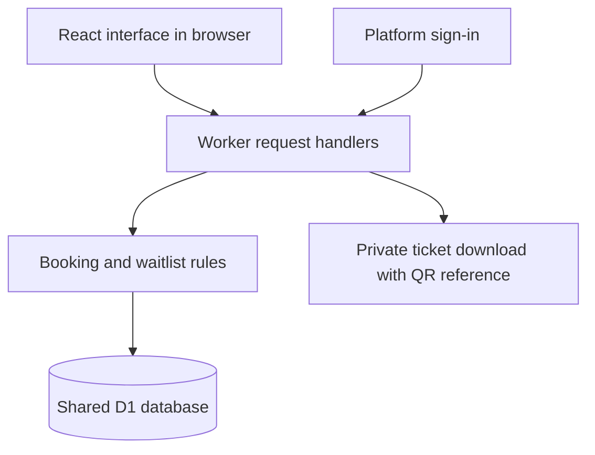
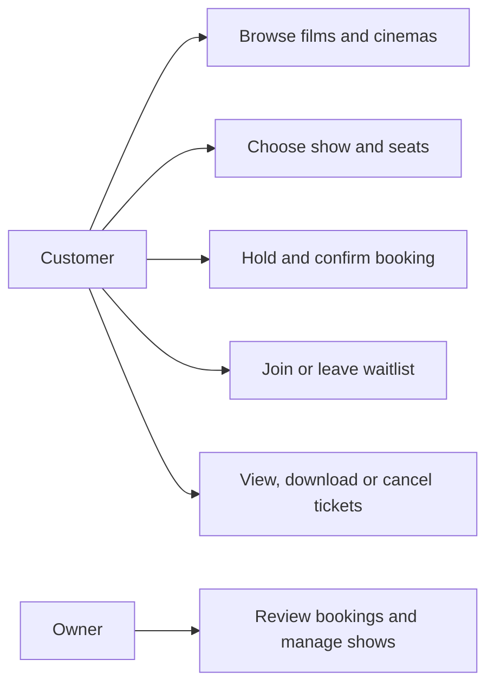
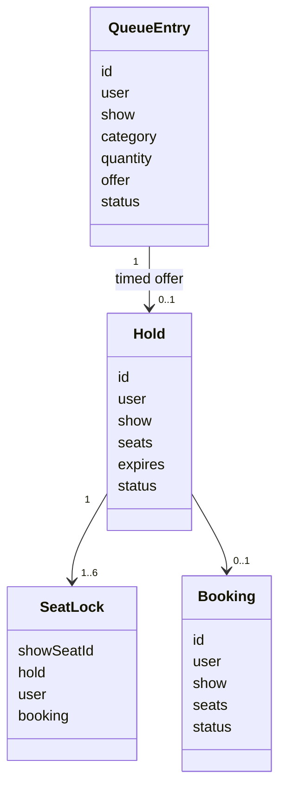
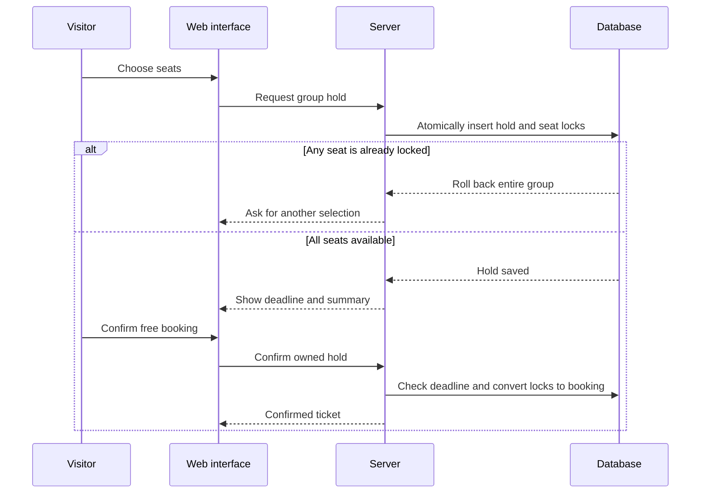
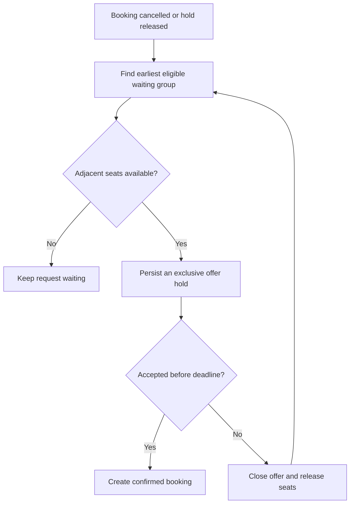

# SHOWTIME: CINEMA BOOKING AND WAITLIST SYSTEM

## Abstract

Showtime is a web application for discovering films and making cinema plans. The project uses Hyderabad as its example city and includes ten cinema names. Five represent multiplexes with several configured screens, while five represent traditional single-screen theatres. Visitors can browse films, choose a cinema and show, select seats and confirm a booking without signing in or making a payment.

The main problem is keeping seat availability correct when several users request the same seats. The application temporarily holds selected seats and checks availability on the server. It also includes a waitlist for people who cannot find adjacent seats in their preferred category. When matching seats become available, the earliest eligible waiting group receives a timed offer.

The interface is developed with React and TypeScript using Node.js development tools. The hosted server runs as a Cloudflare Worker, and D1 stores bookings, seat holds, waiting requests and saved films. This is a student project with working shared records. Its schedules and tickets are demonstrations, not inventory or admission tickets issued by real cinemas.

## Table of contents

1. Introduction
   - Problem statement
   - Proposed solution
   - Scope
2. Related study
3. Proposed system architecture
   - Methodology
   - Layer-wise architecture
   - System components
   - Model representation and UML
4. Implementation
   - Hardware and software requirements
   - Web application development
   - Working methodology
   - Testing and deployment
5. Results and discussion
   - Result analysis
   - UI, sign-in and functionality
   - Performance and accuracy
6. Conclusion
7. References

## 1. Introduction

Cinema booking is more than choosing a film. A visitor needs a suitable cinema, language, date, screen and group of seats. The application should make these choices clear and show correct availability. Traditional theatres and multiplexes also need different screen structures: one venue may have a single auditorium, while another may show different films at the same time on different screens.

### Problem statement

Two visitors may select the same seat before either confirms. If the system only checks the browser, both may receive confirmation. A group booking also needs all selected seats together: accepting only part of a group creates a poor experience. Cancellations create another problem, because waiting visitors may not notice that suitable seats have reopened.

### Proposed solution

Showtime stores an exclusive lock for each selected seat and uses an atomic database batch for group changes. Either every seat is held, or the entire operation fails. Holds last five minutes, allowing the visitor to review the booking. There is no payment step. A waitlist records the show, seat category and number of adjacent seats requested. Matching cancellations can become timed offers rather than requiring repeated manual checks.

### Scope

The project covers Hyderabad, ten cinema references, twenty-two configured screens, eight films and a seven-day demonstration schedule. It supports accounts, search, filters, saved movies, seat holds, free bookings, ticket downloads, cancellations, a waitlist and owner controls. Each show has ninety-six configured seats. A booking can include one to six seats.

Live operator inventory, payment, delivery through email or SMS, refunds and other cities are outside the current implementation. The screen counts and seat plans do not claim to reproduce real cinemas. District is an experience reference, not a partner or a source of booking permission.

## 2. Related study

Manual ticket records require staff to track changes and may be difficult to coordinate between counters. A simple online form improves access but does not itself protect seats from competing requests. Modern movie-booking interfaces combine discovery, show selection and seating plans. Showtime uses this familiar flow while concentrating on shared seat correctness and cancellation recovery.

District's public Hyderabad listings were consulted for catalogue references and visual assets. Official cinema websites and public venue listings were used to check names and localities. This project does not copy or connect to their booking systems. It defines its own demonstration screens, schedules, prices and database.

## 3. Proposed system architecture

### Methodology

The work began with the earlier booking requirements and adapted them for cinema visits. Services became movies; individual appointment slots became shows on specific screens. The next steps were catalogue research, interface design, database modelling, feature development, automated testing, browser testing and publication.

### Layer-wise architecture

The presentation layer shows movie cards, cinema lists, showtimes, seat maps and tickets. The application layer checks identity, input, availability and deadlines. The data layer keeps persistent records. The browser never decides whether a conflicting booking is allowed.

### System components

| Component | Responsibility |
|---|---|
| Catalogue | Film, cinema, screen, date and show information |
| Guest sessions and admin access | Protected browser sessions for customers; separate owner authentication |
| Seat holds | Temporary group reservation with a stored deadline |
| Booking | Free confirmation, history and cancellation |
| Waitlist | Ordered requests for adjacent seats in a category |
| Offers | Exclusive timed holds for eligible waiting groups |
| Watchlist | Saved films private to an account |
| Tickets | Private downloadable reference with a generated QR code |
| Owner tools | Booking overview and show cancellation/reopening |

### Model representation and UML

Queue reconciliation runs during API requests and after cancellation or release. Open browsers refresh automatically. If no request reaches the app, processing resumes on the next request. There is no separate always-running queue worker in this version.

## 4. Implementation

### Hardware and software requirements

A recent dual-core computer with about 8 GB RAM and space for Node.js packages is a reasonable student development setup. These are suggestions, not measured minimum specifications. Development uses a browser, code editor, Git, Node.js, TypeScript, React, Vinext, Drizzle and Wrangler. Production uses a hosted Worker and D1 database.

### Web application development

The main interface contains movie discovery, cinema discovery, film details and show selection, a seat map, watchlist, My tickets and an owner control room. URL parameters identify a movie, cinema or show so visitors can share direct links. The interface includes form labels, keyboard focus, confirmation dialogs and responsive navigation.

The backend has cinema, ticket and management routes. Customer operations require a valid signed guest cookie, created automatically without login. Owner operations require the configured authenticated owner identity. Write requests also check their origin. Queries bind input parameters instead of building SQL from untrusted values. Passwords and payment details are not stored by this application.

### Working methodology

1. A visitor chooses a movie, cinema, date and screen-specific show.
2. The server returns the latest locked seats without exposing another visitor's account information.
3. The visitor selects up to six seats and requests a hold.
4. A database batch inserts all locks together or rejects the entire group.
5. The visitor reviews the stored hold and confirms without payment.
6. The booking appears under My tickets and can be downloaded with a QR reference.
7. Cancellation before showtime releases the seats while preserving the history record.
8. If a matching group is waiting, the server considers the earliest eligible entry and stores an offer.
9. The offer can be confirmed only by its owner before its persisted deadline.

Waitlist requests specify seat category and group size. Adjacent seats must be in the same row and on the same side of the aisle. A group that does not fit may remain waiting while the next eligible group receives an offer. A unique deterministic offer ID protects against duplicate allocation of the same queue entry.

### Testing and deployment

The test suite executes the actual server route code with a transactional SQLite adapter. It covers catalogue integrity, anonymous writes, invalid selections, seat ownership, group rollback, confirmation, private tickets, cancellation, hold expiry, saved films, queue ordering, waitlist promotion, concurrent conflicts and owner controls.

Browser checks cover guest session creation, two-seat selection, hold recovery after reload, confirmation, ticket download, cancellation/history, filters, saved films, waitlist validation, dialogs and mobile navigation. Layouts are checked at phone, tablet and desktop widths. Tests create records only in the local development database.

For publication, source is committed to the hosting repository, the Worker build is packaged, and a saved version is deployed. The public audience allows browsing and guest booking without sign-in. A separate GitHub repository contains the source and project documentation.

## 5. Results and discussion

### Result analysis

At the local verification stage, twenty route-level checks passed. The browser journey also passed for discovery, booking, ticket download, cancellation and saved movies. These results show that the tested workflows behave as designed in the development environment. Public deployment and access checks are recorded in the final handoff after publishing.

### Web application UI

The application uses original Showtime branding, local film artwork, a featured movie, filter chips and cinema cards. The seat map has category prices and a legend. Small screens use bottom navigation and a horizontally scrollable seating plan. Confirmation screens state that no payment is collected and that tickets are project records.

### Guest access and admin login

Customers do not register or sign in. The server creates a signed, HttpOnly browser cookie and verifies it before returning private bookings or accepting changes. Each browser gets a different guest identifier. The session lasts up to 30 days; clearing cookies or changing devices starts a new session. The owner signs in separately through the Admin entry. A guest session cannot grant owner privileges.

### Functionalities of the application

The implementation includes public discovery, shared availability, private watchlists, timed seat holds, free booking, cancellation, history, QR ticket downloads, a fair category waitlist and owner controls. Expired offers are rejected even if the browser still displays them. Owner show cancellation prevents new confirmation and cancels existing project tickets for that show.

### Performance and accuracy

Accuracy means correct allocation, not a prediction score. The conflict test submits twenty competing group-hold requests and expects one successful holder. The result does not prove that the hosted service supports a particular number of real users per second. No commercial-scale load figures or invented percentages are claimed.

Performance can later be measured through API response times, database duration, successful booking counts, error rate and time from cancellation to offer creation. Test conditions must be recorded with those measurements. In-app refresh timing and request-driven reconciliation limit how quickly offers are displayed.

## 6. Conclusion

Showtime adapts the original booking and waitlist idea to a cinema setting. It demonstrates how an account can discover a film, select a screen-specific show, reserve a group of seats, confirm without payment and receive a private ticket. The waitlist gives cancelled seats another chance to be used fairly.

The project is suitable for learning interface development, account permissions, SQL design, conflict handling, testing and deployment. A production cinema service would additionally need operator integrations, independent scheduling, delivery services, retention tooling, monitoring and load validation. The current app is a working project environment with clearly identified demonstration inventory.

## 7. References

1. Node.js documentation: https://nodejs.org/en/learn/getting-started/introduction-to-nodejs
2. React documentation: https://react.dev/learn
3. Cloudflare D1 documentation: https://developers.cloudflare.com/d1/
4. Cloudflare D1 batch API: https://developers.cloudflare.com/d1/worker-api/d1-database/
5. Drizzle documentation: https://orm.drizzle.team/docs/overview
6. QRCode package: https://github.com/soldair/node-qrcode
7. District Hyderabad movie listings: https://www.district.in/movies/hyderabad-movie-tickets
8. Prasads official website: https://prasadz.com/
9. Per-film, cinema and image references: `public/assets/SOURCES.md` and `app/catalog.ts`.

### Public URL and hosting update

The customer address is https://showtime-hyderabad.vercel.app. A Vercel routing deployment forwards to the existing Worker and SQL backend. Personalized pages and API responses are not cached by the proxy. The Admin entry continues to use protected platform sign-in; customer booking never requires it.
